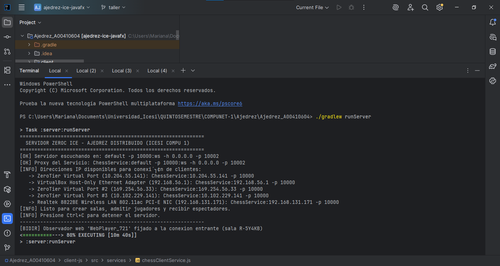
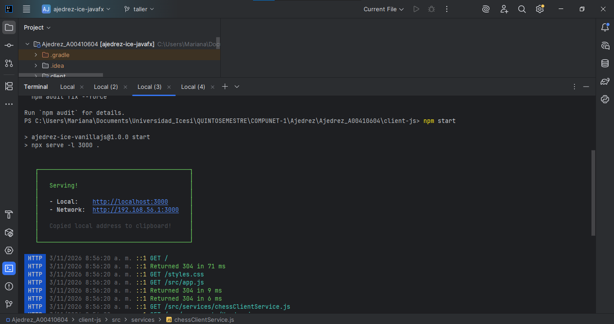
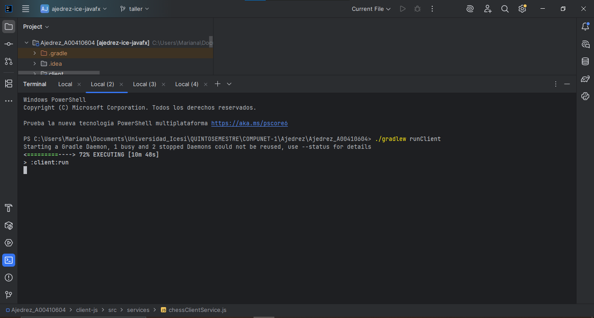
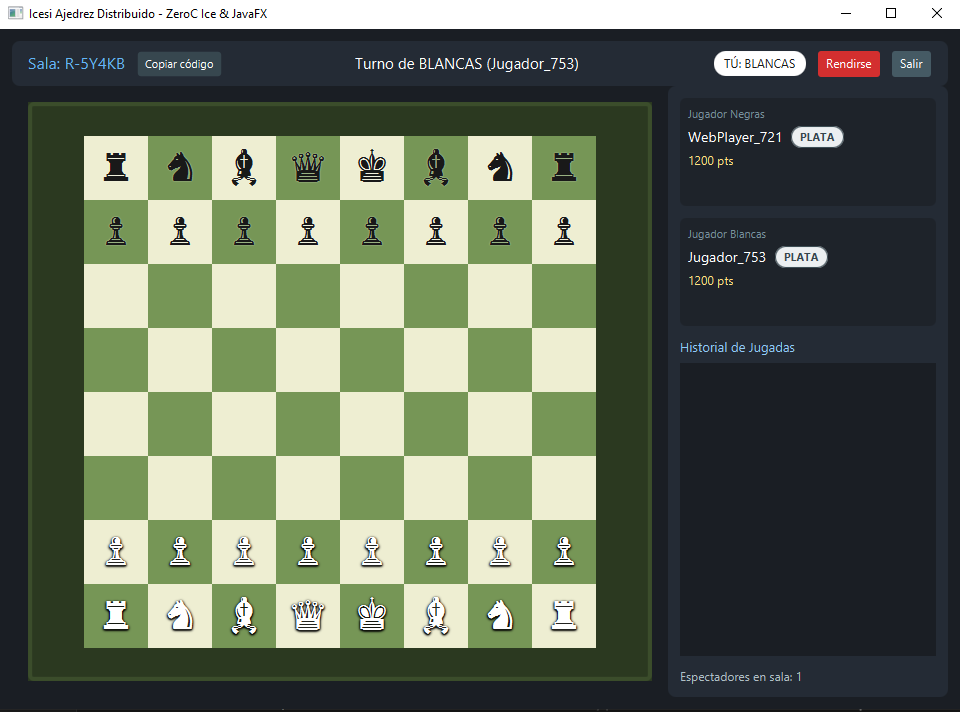
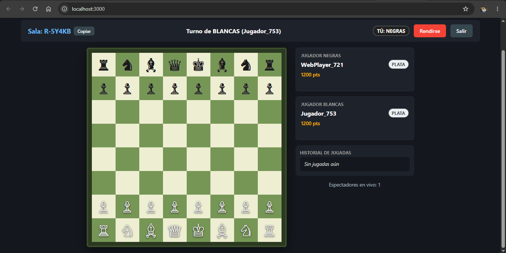
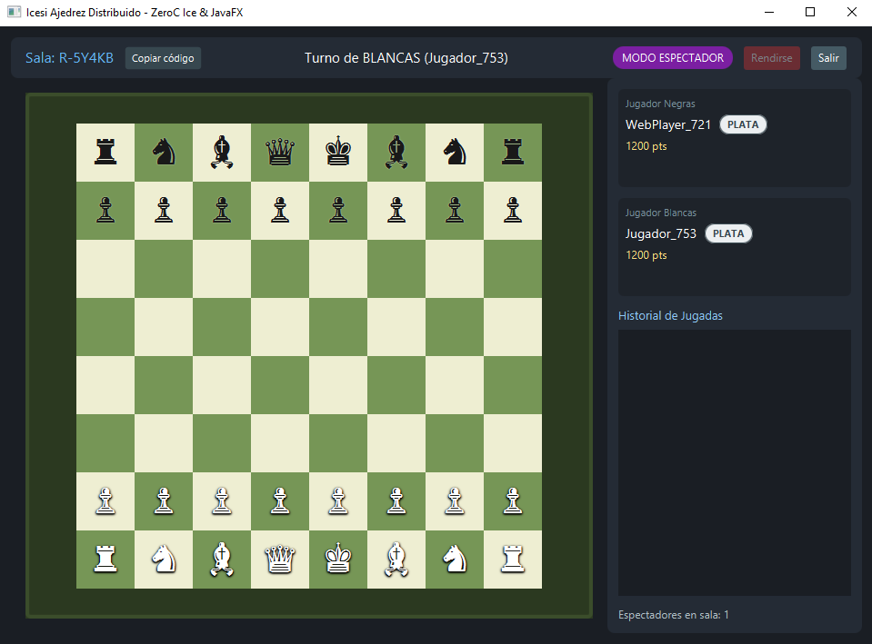

# Evidencias de Funcionamiento

**Taller: Integración de JavaScript Vainilla con ZeroC Ice sobre WebSockets Bidireccionales**
Computación en Internet I (09776) — Semestre 2026-2
Estudiante: Felipe Cuadros Muñoz — Código: A00410604

Las capturas corresponden a una misma sesión de prueba sobre la sala **R-5Y4KB**, con tres
participantes conectados simultáneamente por dos transportes distintos.

---

## 1. Servidor ZeroC Ice con doble endpoint y registro BiDir



El servidor se levanta con `./gradlew runServer` y expone los dos transportes sobre un único
ObjectAdapter, como se ve en la línea de arranque:

```
[OK] Servidor escuchando en: default -p 10000:ws -h 0.0.0.0 -p 10002
```

El `default -p 10000` atiende a los clientes de escritorio JavaFX por TCP y el
`ws -h 0.0.0.0 -p 10002` atiende a los clientes web por WebSocket. Son dos endpoints del mismo
adaptador, con el mismo servant `ChessServiceImpl` registrado una sola vez, por lo que no hay
duplicación de lógica de negocio.

Debajo, el servidor enumera las interfaces de red disponibles para que los clientes remotos
puedan conectarse. En esta máquina aparecen varias porque hay adaptadores virtuales
(ZeroTier, VirtualBox) además de la tarjeta WiFi real.

La línea más relevante de toda la captura es la última:

```
[BIDIR] Observador web 'WebPlayer_721' fijado a la conexion entrante (sala R-5Y4KB)
```

Ese mensaje lo emite la rama que se implementó en `ChessServiceImpl.registerObserver`. Confirma
que el servidor detectó que el proxy del observador llegaba **sin endpoints** —porque el
navegador no puede abrir puertos de escucha— y lo amarró a la conexión WebSocket entrante
mediante `observer.ice_fixed(current.con)`. Sin ese paso, el servidor no tendría dirección a
la cual enviar los callbacks y el tablero del cliente web nunca se actualizaría.

Nótese que el mensaje aparece **una sola vez**, para el jugador web. Los dos clientes JavaFX
no lo disparan, porque sus proxies sí traen endpoints propios y se registran directamente. Esa
discriminación es intencional: aplicar `ice_fixed` a un cliente de escritorio le quitaría al
servidor la capacidad de reconectarse a él.

---

## 2. Servidor web del cliente en JavaScript Vainilla



El cliente web se sirve con `npm start` desde `client-js/`, en el puerto 3000. El log HTTP
muestra la descarga de los módulos ES de la aplicación (`src/app.js`,
`src/services/chessClientService.js`, y de ahí en cascada el resto del árbol de componentes y
servicios).

Que todas las respuestas sean `200` o `304` y no haya ningún `404` confirma que el contrato
compilado `src/services/ChessService.js` está presente. Este archivo se genera con `slice2js`
a partir de `common/src/main/slice/ChessService.ice` y es el que publica el espacio de nombres
`window.ChessApp` en el navegador.

---

## 3. Cliente de escritorio JavaFX



El cliente de escritorio se lanza con `./gradlew runClient` en una terminal independiente. Cada
ejecución abre una instancia separada, lo que permite conectar varios participantes desde la
misma máquina durante las pruebas.

---

## 4. Jugador de blancas — Cliente JavaFX (TCP, puerto 10000)



Primer participante en entrar a la sala `R-5Y4KB`. El servidor le asignó automáticamente el rol
de **blancas**, visible en la insignia `TÚ: BLANCAS` de la barra superior, y el botón
*Rendirse* está habilitado porque es un jugador activo.

La barra central indica `Turno de BLANCAS (Jugador_753)`, que coincide con el estado inicial
de una partida de ajedrez. Las tarjetas laterales muestran a ambos jugadores con 1200 puntos y
la insignia **PLATA**, que es el tier que corresponde al rango 1200–1499 según el escalafón del
proyecto. El contador inferior reporta un espectador en sala.

---

## 5. Jugador de negras — Cliente Web en JavaScript Vainilla (WebSocket, puerto 10002)



Segundo participante, conectado desde el navegador a `127.0.0.1:10002` por WebSocket. El
servidor le asignó el rol de **negras** (`TÚ: NEGRAS`) y con su entrada la partida pasó a estado
`INPROGRESS`.

Esta captura evidencia el funcionamiento de los tres componentes DOM implementados:

- **`ChessBoard.render`** dibujó la grilla de 8×8 alternando las clases `tile light` y
  `tile dark`, y colocó las 32 piezas con sus glifos Unicode correspondientes, diferenciando
  `piece-white` de `piece-black`.
- **`PlayerCard.update`** muestra los nicknames recibidos del servidor, el puntaje con el
  formato `1200 pts` y la insignia de tier calculada con `calculateTierFromPoints`.
- **`MoveHistory`** muestra el estado vacío `Sin jugadas aún`, que es el comportamiento
  especificado cuando el arreglo `moves` del `GameState` está vacío.

Lo importante para efectos de interoperabilidad es que el estado mostrado aquí es **idéntico**
al del cliente JavaFX de la sección anterior: misma sala, mismo turno, mismos jugadores, mismo
conteo de espectadores. Ambos clientes consumen el mismo `GameState` del mismo servant, aunque
lleguen por transportes diferentes.

---

## 6. Tercer participante en modo espectador — Cliente JavaFX



Al estar ya ocupados los dos puestos de jugador, el tercer participante en unirse al código
`R-5Y4KB` recibe automáticamente el rol de **espectador**, señalizado con la insignia morada
`MODO ESPECTADOR`.

El botón *Rendirse* aparece deshabilitado (en gris), porque un espectador no puede alterar el
curso de la partida. Aun así recibe el estado completo: ve el mismo tablero, las mismas
tarjetas de jugadores y el mismo turno activo que los dos jugadores.
